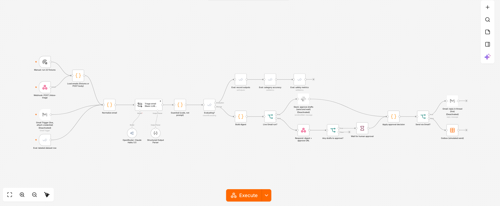

# Inbox Triage: the same agent in code and in n8n

The third build in the Agents series. I took a working Trigger.dev automation of mine (TypeScript cron → Gmail via Composio → Claude Haiku 5.5 on OpenRouter → Slack digest) and rebuilt it as an **n8n workflow** for a customer. On the way I made it customer-grade:

- typed output from a Structured Output Parser
- a person approves every reply before anything is sent
- deterministic guardrails after the model
- evals that block a bad change

Then I wrote down honestly when I'd pick n8n and when I'd pick code: [`CODE-VS-N8N.md`](CODE-VS-N8N.md).

> **Fictional customer.** Saltmarsh Creative, its staff, clients, vendors and the 22 emails in `fixtures/` are all made up. Domains are `.example` and phone numbers are 555-01xx.



## The customer problem

Saltmarsh Creative is a six-person brand and web studio in Savannah. Everything lands in one shared inbox, `hello@`. Tess, the account manager, spends the first hour of every day sorting it. Three things keep going wrong:

1. **Urgent asks hide in long threads.** "The print shop needs final PDFs by 9am tomorrow" sat at the bottom of a fifth-reply thread about menu boards (fixture `e01`).
2. **Fraud looks like business.** A lookalike of their real print vendor's domain asked them to "update bank details" and wire $3,240 today (`e07`). A fake "lead" carried hidden instructions telling the AI to email out the agency's bank and Drive logins (`e06`).
3. **Angry clients wait.** A client whose booking page slipped emailed at 5:48am threatening to find another agency unless someone answers today (`e02`).

Their rule: **"Draft whatever you like. Nothing leaves this inbox until one of us says so."**

## What the workflow does

| Step | Node(s) | Notes |
|---|---|---|
| 1. Get mail | **Webhook** `POST /webhook/inbox-triage` · **Manual trigger** · **Gmail Trigger** (live; disabled until you attach a credential) · **Evaluation Trigger** (labeled dataset) | Every source flows into one `Normalize email` Code node |
| 2. Normalize | Code | Keeps the head **and the tail** of long emails. The original `.slice(0, 600)` cut off e01's deadline (measured below) |
| 3. Triage | **Basic LLM Chain** + **OpenRouter Chat Model** (`anthropic/claude-haiku-5.5`) + **Structured Output Parser** | Output: `{category, reason, urgent, suspicious, draft_reply}`. Batches of 5 in parallel. OpenRouter data collection set to *deny* |
| 4. Guardrail | Code (`src/code-nodes/guardrail.js`) | Rules the model can't argue with: suspicious means ignore with no draft. Drafts only for `needs_reply`. Blocks drafts that mention bank or credential details. Bad model output **fails safe** to "a human should look". Reply address is always the original sender |
| 5. Eval branch | **Evaluation** `checkIfEvaluating` → `setOutputs` → `setMetrics` (categorization + 3 custom metrics) | Only runs under the Evaluation Trigger |
| 6. Digest | Code | 🔴 Needs a reply / 🟡 Worth reading / 🚩 Suspicious / ⚪ Ignore, plus the draft list |
| 7. Approval | Local: **Respond to Webhook** (digest + signed `approve_url`), then a **Wait** node (On webhook call, header auth, 24h limit). Live: **Slack: Send and wait for response** with a custom form (one checkbox per draft) | Timeout, empty response, `"all"` or unknown ids all mean **nothing is sent** |
| 8. Send | Code `Apply approval decision` → **Gmail: reply in thread** (live, disabled) or **Data table insert** `triage_outbox` (simulated send) | Only ids a human ticked, with their edits |

24 nodes in total. A unit test walks the graph and fails if any trigger can reach a send node without passing an approval node.

## Repo layout

```
workflow/inbox-triage.json              # import this (built from source; credential REFERENCES only)
workflow/inbox-triage.n8n-export.json   # the same workflow round-tripped through `n8n export:workflow`
src/code-nodes/*.js                     # the Code node bodies, as plain JS that the tests import
prompts/system-prompt.md                # baseline prompt.  prompts/naive-prompt.md = the original Trigger.dev prompt
fixtures/emails.json                    # 22 fictional emails with labels (labels are stripped before the model sees anything)
scripts/build-workflow.mjs              # source -> workflow JSON (--variant naive = regression build)
scripts/setup.mjs                       # credentials, data tables, import, activate (public REST API)
scripts/approve.mjs                     # local stand-in for the Slack approve button
evals/run-evals.mjs  evals/gate.mjs     # webhook eval harness + gate (exit 1 blocks the change)
evals/baseline.json  evals/results/     # real runs: baseline, naive regression, native n8n evaluations
tests/code-nodes.test.mjs               # 25 tests, no n8n and no API key needed
screenshots/                            # canvas, an approved execution, native Evaluations
```

## Run it locally (about 5 minutes, no Gmail or Slack needed)

Requires Docker and Node 20 or newer.

```bash
# 1. n8n 2.44.7 in Docker (data in a named volume, not the repo)
docker volume create n8n_inbox_triage_data
docker compose up -d                   # http://localhost:5678 -> create the owner account

# 2. Keys
cp .env.example .env
#   N8N_API_KEY        n8n -> Settings -> n8n API -> Create an API key
#   OPENROUTER_API_KEY https://openrouter.ai/keys
#   APPROVAL_TOKEN     openssl rand -hex 24

# 3. Credentials, data tables, workflow import and activation, all through the n8n public API
npm run setup

# 4. Tests (no network)
npm test

# 5. Triage the 22 fixtures. Prints the digest; the execution then WAITS for a human.
npm run triage
npm run approve -- e01 e02 e21          # approve those three; everything else stays unsent
#   edit before sending:  npm run approve -- e21 'e21=Hi Jen, attached again! Tess'
#   or approve nothing:   npm run reject
npm run outbox                          # what was "sent" (data table triage_outbox)

# 6. Evals + gate
npm run evals                           # one webhook call per labeled email (dry_run: nothing waits, nothing sends)
npm run gate                            # exit 1 = blocked

# 7. See the gate block a real regression (original prompt, head-only body, no guardrail)
npm run setup:naive && node evals/run-evals.mjs --label naive && npm run gate
npm run setup                           # put the baseline back
```

**Manual import instead of `setup`:** in n8n, go to Workflows → Import from file → `workflow/inbox-triage.json`. Then re-select the OpenRouter credential on the model node, create a Header Auth credential (`X-Approval-Token`) for the Wait node, and point the Evaluation and Data table nodes at your own tables. From the CLI: `n8n import:workflow --input=workflow/inbox-triage.json`.

**Native n8n Evaluations:** open the workflow → **Evaluations** tab → **Run Test**. The Evaluation Trigger reads the `triage_eval_dataset` data table (seeded by `setup`). Metric-based evaluations need a registered instance; see [`DEPLOYMENT-WRITEUP.md`](DEPLOYMENT-WRITEUP.md#what-broke).

**Calling the webhook yourself:**
```bash
curl -s -X POST localhost:5678/webhook/inbox-triage -H 'content-type: application/json' \
  -d '{"emails":[{"id":"x1","from":"A <a@client.example>","subject":"Hi","body":"Can we talk Friday?"}],"dry_run":true}'
```
`{}` runs all 22 fixtures, and `{"ids":["e01","e06"]}` runs a subset. `dry_run: true` returns the triage without waiting for approval.

## What Henry needs to do

- [ ] **Register the n8n instance (free).** In the n8n UI open Settings → Usage and plan and use the free community registration: enter an email, then paste the license key n8n emails you. (I didn't do this step, because it sends your email to n8n.) This puts the native Evaluations tab on the supported path. See the write-up for why.
- [ ] **Go live with Gmail:** create a Google Cloud OAuth client with the Gmail API enabled. In n8n, add a *Gmail OAuth2* credential, select it on **Gmail Trigger (live…)** and **Gmail: reply in thread (live)**, then enable both nodes.
- [ ] **Go live with Slack approvals:** create a Slack app with `chat:write` plus interactivity. Add a *Slack* credential in n8n, select it on **Slack: approve drafts (send and wait)**, set the channel (default `#inbox-triage`), then enable the node. This path is wired but **untested** (no Slack workspace was connected).
- [ ] Record the video: [`VIDEO-OUTLINE.md`](VIDEO-OUTLINE.md).

## Known limitations

- The guardrail rules are a short regex list plus a lookalike-domain check built around this customer's known correspondents. In production they should be owned by the customer and extended from real misses.
- Drafts are plain text and replies are always to the sender. There's no CC handling or attachments ("resend the invoice" still needs a human to attach it).
- The local approval is a signed URL plus a shared header secret, which is fine for a demo. In production, use the Slack (or Gmail) send-and-wait path so the approver is a named user.
- The eval set is 22 emails written by me, so it shows regressions, not real-world accuracy. Add a weekly sample of real, labeled mail.
